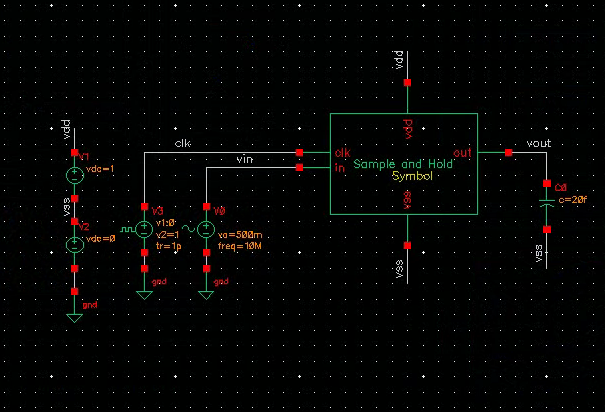
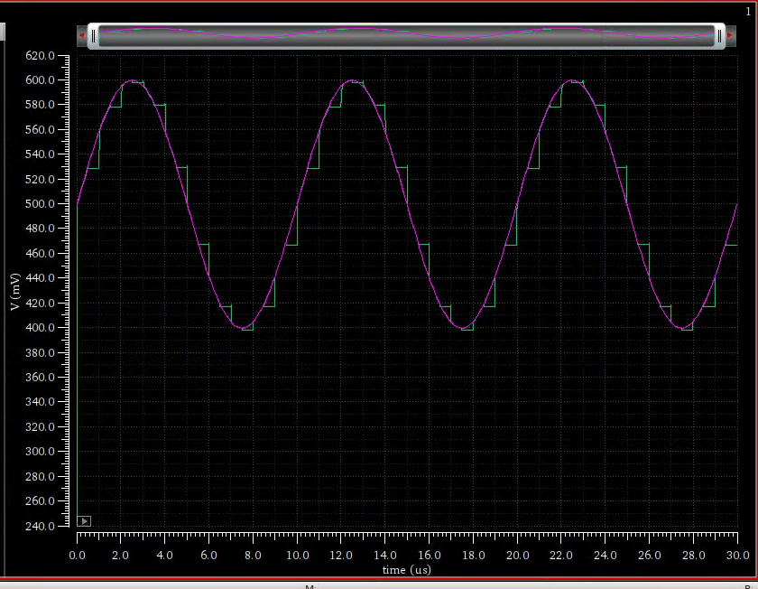
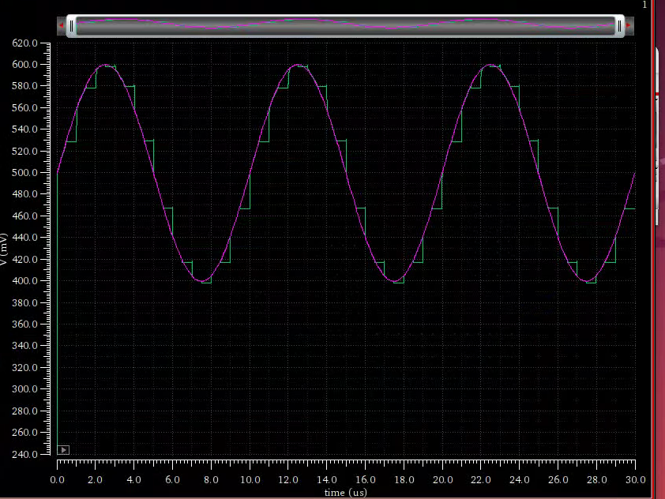

# CMOS Sample-and-Hold and Track-and-Hold Circuits

A collection of CMOS sampling circuit designs, behavioral models, and simulation studies developed using **Cadence Virtuoso**. This repository contains the design and verification of Sample-and-Hold (S/H) and Track-and-Hold (T/H) circuits, covering Verilog-A behavioral modeling, transistor-level circuit design, testbench development, and simulation-based performance evaluation.

---

## Project Overview

Sample-and-Hold and Track-and-Hold circuits are fundamental building blocks in analog and mixed-signal systems, particularly in data acquisition systems, analog-to-digital converters (ADCs), and signal-processing applications.

This project explores two sampling circuit architectures:

1. **Sample-and-Hold (S/H):** A Verilog-A behavioral implementation demonstrating clock-controlled sampling and holding operation.
2. **Track-and-Hold (T/H):** A transistor-level CMOS implementation designed and simulated using TSMC 180 nm technology.

Both designs were verified through Cadence Virtuoso simulation environments.

## Design Environment and Tools

| Parameter | Description |
|---|---|
| EDA Tool | Cadence Virtuoso |
| Process Technology | TSMC 180 nm CMOS (Track-and-Hold) |
| Behavioral Modeling | Verilog-A (Sample-and-Hold) |
| Circuit Design | Transistor-level CMOS (Track-and-Hold) |
| Simulation | Transient Analysis |
| Additional Analysis | Periodic AC (PAC) Analysis |
| Verification | Cadence Virtuoso Testbenches |

---

# 1. Sample-and-Hold Circuit

## 1.1 Design Overview

A Sample-and-Hold circuit captures the instantaneous value of an analog input signal during the sampling phase and maintains the captured value during the hold phase.

In this project, a behavioral model of the Sample-and-Hold circuit was developed using Verilog-A and simulated in Cadence Virtuoso.

The model uses a clock signal to control the tracking and holding behavior.

## 1.2 Verilog-A Behavioral Modeling

The Sample-and-Hold circuit was modeled using Verilog-A with configurable clock threshold, transition delay, and transition time parameters.

**Source Code:** [`sample_and_hold.va`](Sample-and-Hold/verilog-a/sample_and_hold.va)

### Model Parameters

| Parameter | Default Value | Description |
|---|---:|---|
| `clk_vth` | 0.5 V | Clock threshold voltage |
| `delay` | 0 | Output transition delay |
| `ttime` | 1 ps | Output transition time |

### Operating Principle

The behavioral model implements the following operation:

- **Tracking phase:** When the clock voltage is above the specified threshold, the output state follows the input signal.
- **Hold phase:** At the falling threshold crossing of the clock, the input value is captured and maintained until the next tracking phase.

The Verilog-A `transition()` function is used to model the output transition behavior.

## 1.3 Testbench Design

A dedicated testbench was developed in Cadence Virtuoso to evaluate the behavioral model.

The testbench includes:

- Verilog-A Sample-and-Hold model.
- Analog input signal source.
- Clock signal source.
- Supply voltage sources.
- Output load capacitor.

### Testbench Schematic



## 1.4 Simulation Results

### Transient Input-Output Response

Transient analysis was performed to verify the clock-controlled sampling behavior and the relationship between the input and output signals.

The simulation waveform demonstrates the input-output response of the behavioral model.



---

# 2. Track-and-Hold Circuit

## 2.1 Design Overview

A Track-and-Hold circuit continuously tracks an analog input signal during the tracking phase and maintains the last tracked value during the hold phase.

Unlike the Sample-and-Hold circuit, which captures an instantaneous input value at the sampling transition, the Track-and-Hold circuit follows the input throughout the tracking interval.

A transistor-level CMOS Track-and-Hold circuit was designed and simulated using Cadence Virtuoso with the TSMC 180 nm process technology.

## 2.2 Circuit Implementation

The circuit includes a CMOS sampling switch implemented using an NMOS transistor.

The transistor-level implementation was designed to investigate the switching behavior and the tracking and holding characteristics of the circuit.

### Circuit Schematic


## 2.3 Testbench Design

A dedicated Cadence Virtuoso testbench was developed to evaluate the circuit response.

The testbench provides the input signal, clock control, supply connections, and output load required for transient and periodic AC simulations.

### Testbench Schematic


## 2.4 Simulation and Verification

The Track-and-Hold circuit was evaluated using transient and Periodic AC (PAC) analyses.

### Transient Analysis

Transient simulation was performed to examine the input-output relationship and verify the circuit's tracking and holding behavior.



### Periodic AC Analysis

Periodic AC analysis was performed to investigate the frequency-dependent response of the circuit.


---

# 3. Repository Structure

```text
CMOS-Track-and-Hold-Circuit/
│
├── README.md
│
├── Sample-and-Hold/
│   │
│   ├── verilog-a/
│   │   └── sample_and_hold.va
│   │
│   ├── testbench/
│   │   └── testbench.png
│   │
│   └── simulation-results/
│       └── input_and_output.png
│
└── Track-and-Hold/
    │
    ├── schematic/
    │   └── schematic.png
    │
    ├── testbench/
    │   └── test_bench.png
    │
    └── simulation-results/
        ├── input_vs_output.png
        └── pac_output.png
```

---

# 4. Key Features and Work Completed

- Developed a Verilog-A behavioral model of a Sample-and-Hold circuit.
- Designed a transistor-level CMOS Track-and-Hold circuit using TSMC 180 nm technology.
- Implemented and evaluated CMOS sampling switch behavior.
- Developed Cadence Virtuoso testbenches for circuit verification.
- Performed transient simulations to investigate input-output tracking and holding behavior.
- Conducted Periodic AC analysis to evaluate frequency response.
- Studied clock-controlled sampling behavior and analog signal handling.

---

# 5. Applications

Sample-and-Hold and Track-and-Hold circuits are widely used in:

- Analog-to-Digital Converters (ADCs).
- Data acquisition systems.
- Mixed-signal integrated circuits.
- Analog signal-processing systems.
- Measurement and instrumentation circuits.

---

# Author

**Sheikh Tariful Islam**

Electrical and Electronic Engineering (EEE)  
Bangladesh University of Engineering and Technology (BUET)

Research Fellow – Analog and Mixed-Signal IC Design  
Center for Research Excellence in Semiconductor Technology (CREST)

---

*Designed and simulated using Cadence Virtuoso.*
