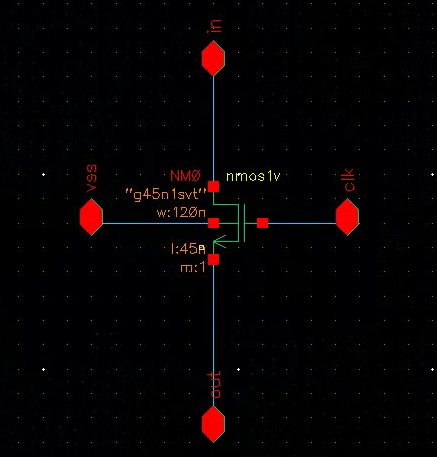
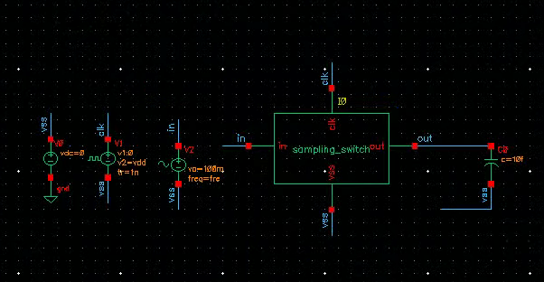
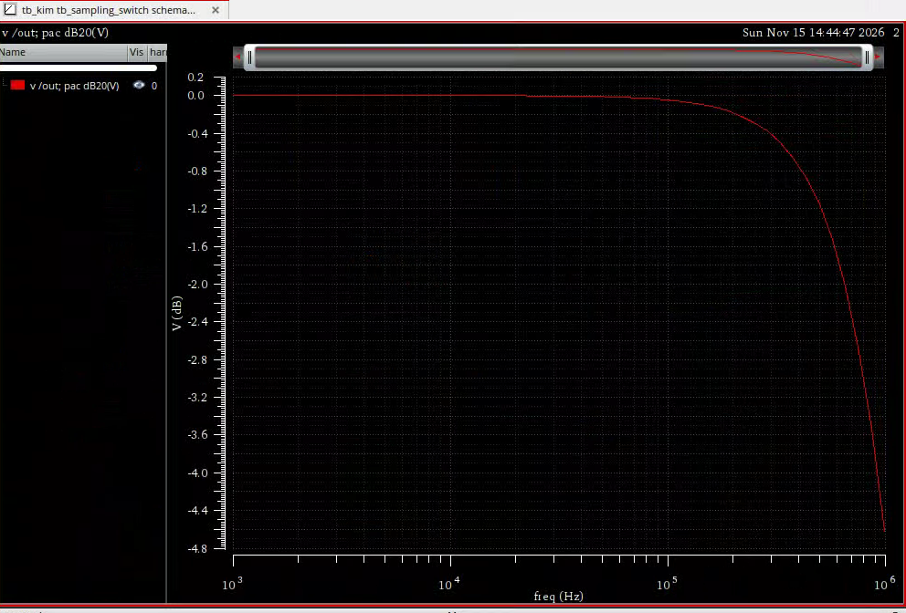

# CMOS Track-and-Hold Circuit

A transistor-level Track-and-Hold (T/H) circuit designed and verified using Cadence Virtuoso in TSMC 180 nm CMOS technology.

## Design Environment

- EDA Tool: Cadence Virtuoso
- Technology: TSMC 180 nm CMOS
- Circuit: Track-and-Hold
- Verification: Transient and Periodic AC (PAC) Analysis

## Circuit Schematic

## Testbench

## Simulation Results

### Transient Analysis

The transient simulation demonstrates the input-output tracking behavior and sampled signal response.

### Periodic AC Analysis

The PAC simulation illustrates the frequency-dependent response of the circuit.

## Project Highlights

- Transistor-level CMOS sampling switch implementation.
- Cadence Virtuoso schematic design.
- Transient simulation and input-output response verification.
- Periodic AC frequency-response analysis.

## Author

Designed and simulated using Cadence Virtuoso.
